<div align="center">
  <table style="border: none;" border="0" cellspacing="0" cellpadding="0">
    <tr>
      <td align="center" width="33%">
        
      </td>
      <td align="center" width="33%">
        
      </td>
      <td align="center" width="33%">
        
      </td>
    </tr>
  </table>
</div>

<div align="center">

<!--START_SECTION:waka-->

```txt
From: 10 January 2025 - To: 03 November 2026

Total Time: 2,450 hrs 11 mins

Python         1,187 hrs 37 mins     ████████████░░░░░░░░░░░░░   47.38 %
TypeScript     633 hrs 49 mins       ██████▒░░░░░░░░░░░░░░░░░░   25.29 %
Markdown       130 hrs 54 mins       █▒░░░░░░░░░░░░░░░░░░░░░░░   05.22 %
YAML           122 hrs 17 mins       █▒░░░░░░░░░░░░░░░░░░░░░░░   04.88 %
Text           73 hrs 40 mins        ▓░░░░░░░░░░░░░░░░░░░░░░░░   02.94 %
```

<!--END_SECTION:waka-->

  

</div>
