<div align="center">
  <table style="border: none;" border="0" cellspacing="0" cellpadding="0">
    <tr>
      <td align="center" width="33%">
        
      </td>
      <td align="center" width="33%">
        
      </td>
      <td align="center" width="33%">
        
      </td>
    </tr>
  </table>
</div>

<div align="center">

<!--START_SECTION:waka-->

```txt
From: 10 January 2025 - To: 27 November 2026

Total Time: 2,550 hrs 18 mins

Python         1,225 hrs             ███████████▓░░░░░░░░░░░░░   46.95 %
TypeScript     655 hrs 12 mins       ██████▒░░░░░░░░░░░░░░░░░░   25.11 %
Markdown       146 hrs 25 mins       █▒░░░░░░░░░░░░░░░░░░░░░░░   05.61 %
YAML           125 hrs 56 mins       █▒░░░░░░░░░░░░░░░░░░░░░░░   04.83 %
Text           82 hrs 11 mins        ▓░░░░░░░░░░░░░░░░░░░░░░░░   03.15 %
```

<!--END_SECTION:waka-->

  

</div>
