<div align="center">
  <table style="border: none;" border="0" cellspacing="0" cellpadding="0">
    <tr>
      <td align="center" width="33%">
        
      </td>
      <td align="center" width="33%">
        
      </td>
      <td align="center" width="33%">
        
      </td>
    </tr>
  </table>
</div>

<div align="center">

<!--START_SECTION:waka-->

```txt
From: 10 January 2025 - To: 05 November 2026

Total Time: 2,470 hrs 50 mins

Python         1,196 hrs 25 mins     ████████████░░░░░░░░░░░░░   47.34 %
TypeScript     637 hrs 52 mins       ██████▒░░░░░░░░░░░░░░░░░░   25.24 %
Markdown       133 hrs 57 mins       █▒░░░░░░░░░░░░░░░░░░░░░░░   05.30 %
YAML           122 hrs 44 mins       █▒░░░░░░░░░░░░░░░░░░░░░░░   04.86 %
Text           75 hrs 13 mins        ▓░░░░░░░░░░░░░░░░░░░░░░░░   02.98 %
```

<!--END_SECTION:waka-->

  

</div>
